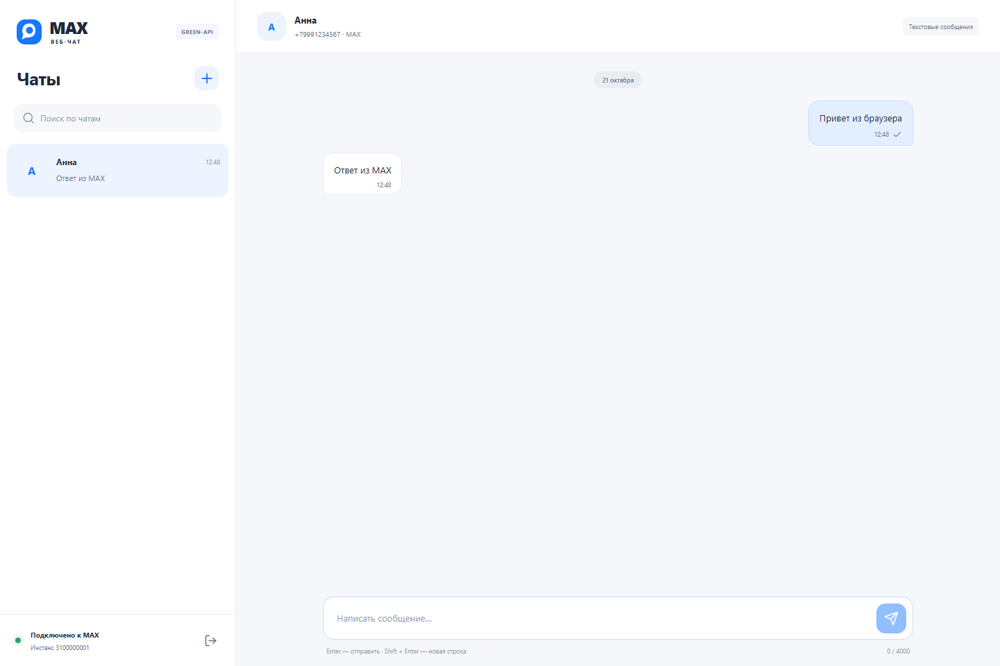

# Чат MAX через GREEN-API

Небольшой веб-клиент для отправки и получения текстовых сообщений в MAX через
GREEN-API. Тестовое задание на позицию frontend-разработчика React.

**React · TypeScript · Vite · fetch · CSS**

**[Открыть приложение](https://max-chat.2-56-126-240.nip.io/)** ·
[Исходный код](https://github.com/iowa-iowa/max-green-chat) ·
[Развёртывание на сервере](deploy/README.md)



## Проверка задания

Реальный обмен в MAX проверен **21 октября 2026 года**: тестовое сообщение
доставлено и прочитано, ответ «Получено» появился в той же переписке без дублей.
[Протокол проверки](docs/verification/2026-10-21-live-max.md).
В репозитории и на сервере нет ключей инстанса: проверяющий вводит свои данные.

## Быстрый запуск

Нужен Node.js **22.12+** или **24+** и npm. Проверено на Node.js 24.

```bash
git clone https://github.com/iowa-iowa/max-green-chat.git
cd max-green-chat
npm ci
npm run dev
```

Откройте адрес, напечатанный Vite (обычно http://127.0.0.1:5173).
Переменные окружения и серверная часть не нужны: данные инстанса вводятся в интерфейсе.

## Подготовка GREEN-API

1. Зарегистрируйтесь в [кабинете GREEN-API](https://console.green-api.com/).
2. Создайте инстанс **MAX**, выберите подходящий тариф и подключите свой аккаунт MAX.
   Это интеграция с пользовательским аккаунтом, а не MAX Bot API.
3. Убедитесь, что состояние инстанса — `authorized`.
4. В настройках инстанса включите **«Получать уведомления о входящих сообщениях и файлах»**
   (`incomingWebhook: "yes"`). Для обновления статусов отправки включите также
   уведомления **о сообщениях с телефона**, **о сообщениях через API** и
   **о статусах отправленных сообщений**: `outgoingMessageWebhook: "yes"`,
   `outgoingAPIMessageWebhook: "yes"`, `outgoingWebhook: "yes"`.
   [Настройки статусов в документации](https://green-api.com/v3/docs/api/receiving/notifications-format/statuses/OutgoingMessageStatus/).
5. Очистите **Webhook URL** (`webhookUrl: ""`). HTTP API и отдельный webhook-получатель
   не должны одновременно забирать одну очередь. После изменения настроек подождите около минуты.
6. Введите в форме `idInstance`, `apiTokenInstance` и **точный `apiUrl` из кабинета**,
   например `https://3100.api.green-api.com`. Значение по умолчанию замените своим,
   если оно отличается от адреса в кабинете.

При подключении приложение проверяет состояние и настройки входящих сообщений.
Настройки инстанса автоматически не изменяются.

## Проверка с двумя аккаунтами

1. Подключите первый аккаунт MAX к инстансу GREEN-API и войдите в веб-клиент.
2. Нажмите «Новый чат» и введите номер второго аккаунта в международном формате.
   Поддерживаются номера РФ `+7` и Беларуси `+375` — ограничение MAX CheckAccount.
3. У второго аккаунта должен быть разрешён поиск по номеру. Настройки приватности,
   блокировки и ограничения MAX могут препятствовать созданию чата.
4. Напишите сообщение и отправьте кнопкой или Enter. Shift + Enter добавляет строку.
5. Откройте MAX на втором аккаунте, получите сообщение и ответьте.
6. Ответ появится в той же переписке веб-клиента. Создайте другой чат и проверьте
   счётчик непрочитанных и сохранение черновика при переключении.
7. Нажмите «Отключиться»: клиент остановит получение, очистит данные текущей сессии
   и вернёт пустую форму. Сам аккаунт в GREEN-API остаётся подключённым.

## Что реализовано

- Подключение через пользовательский инстанс GREEN-API.
- Проверка номера `CheckAccount` и сохранение возвращённого **MAX chatId**.
  Входящее сообщение сопоставляется с существующим чатом по этому идентификатору.
- Отправка текста до 4000 символов методом `SendMessage`.
- Последовательный long polling `ReceiveNotification` → обработка → `DeleteNotification`.
- Получение простого текста и текста с URL; остальные типы событий пропускаются
  и подтверждаются, чтобы не блокировать очередь. Статусы исходящих отображаются при включённых уведомлениях.
- Защита от повторных входящих по id сообщения, непрочитанные, поиск и отдельные черновики.
- Отмена сетевых запросов при выходе, таймауты и восстановление получения после сетевых ошибок.
- При ошибке отправки черновик сохраняется; автоматической повторной отправки нет.
  Если сервер успел принять запрос, но ответ потерялся, перед повтором проверьте MAX.
- Клавиатурная навигация, модальное окно с удержанием фокуса, адаптация к телефону.

## Сборка и тесты

```bash
npm test
npm run build
npm run preview
```

Production-файлы находятся в `dist/`: их можно разместить на статическом HTTPS-хостинге.
Для разработки Vite слушает только локальный интерфейс.

Браузерные тесты используют локальный dev-сервер и **замоканные HTTP-ответы GREEN-API**,
без реальных ключей и отправки сообщений. По умолчанию нужен установленный Google Chrome.

```bash
npm run test:e2e
```

При отсутствии Chrome установите Chromium (`npx playwright install chromium`)
и удалите `channel: 'chrome'` в `playwright.config.ts`.

Unit-тесты проверяют формат номера, reducer, дедупликацию, API-ошибки и порядок
подтверждения уведомлений. Браузерные тесты проверяют основной сценарий,
ошибку отправки, очистку токена и мобильные размеры 320/375/414/768 px.
Это не заменяет ручной обмен с настоящим инстансом MAX по сценарию выше.

## Структура

```text
src/
  api.ts                 # GREEN-API, проверка параметров и ответов
  model.ts               # типы, номера, разбор событий, состояние чатов
  polling.ts             # последовательное получение и подтверждение
  App.tsx                # сессия и экран переписки
  components/            # подключение, новый чат, знак MAX
  styles.css             # адаптивный интерфейс
  *.test.ts              # unit-тесты
e2e/chat.spec.ts          # браузерные сценарии
```

## Границы решения

Токен, переписка и черновики хранятся **только в оперативной памяти вкладки**.
После обновления или закрытия вкладки они исчезают; история MAX не загружается.
Уже подтверждённые уведомления удалены из очереди GREEN-API. При ошибке подтверждения
повторная доставка внутри сессии не дублирует сообщение.

Ключ виден владельцу браузера в сетевых запросах — это клиентская интеграция с вводом
собственных учётных данных по ТЗ. Ключ не включён в сборку, не пишется в localStorage,
sessionStorage или логи и передаётся только на разрешённые HTTPS-хосты GREEN-API.
Проверка хоста не заменяет проверку `apiUrl` в личном кабинете.

Используйте один открытый клиент на инстанс: несколько вкладок, ботов или других
потребителей одной очереди могут перехватывать сообщения друг у друга. Без отдельного
сервера возможности доступа определяются CORS-политикой GREEN-API; не отключайте защиту браузера.

Не реализованы медиа, звонки, редактирование, синхронизация истории и восстановление сессии:
по заданию требуется только обмен текстом. Это самостоятельная учебная реализация,
не официальный веб-клиент MAX.

## Документация API

- [SendMessage](https://green-api.com/v3/docs/api/sending/SendMessage/)
- [HTTP API получения](https://green-api.com/v3/docs/api/receiving/technology-http-api/)
- [CheckAccount](https://green-api.com/v3/docs/api/service/CheckAccount/)
- [Формат запросов](https://green-api.com/v3/docs/request-format/)

## Развёртывание

Приложение размещено на сервере в Варшаве. Nginx отдаёт статическую сборку по HTTPS;
отдельные сервер приложений, база данных и сохранённые API-ключи не нужны.
Исходящий обмен с GREEN-API идёт непосредственно из браузера пользователя.

[Инструкция обновления, настройки Nginx и отката](deploy/README.md).
